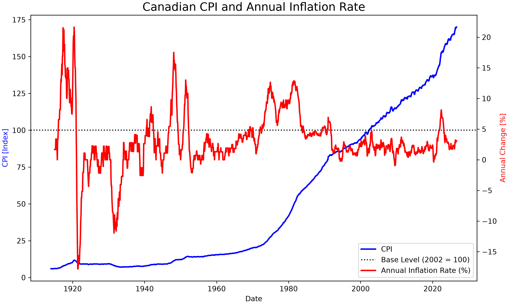
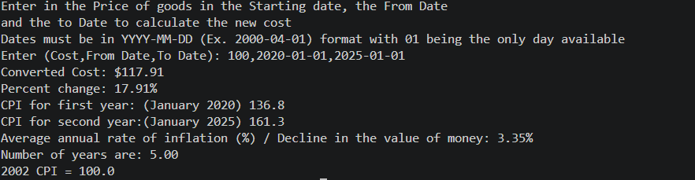

# FINE3300-2026-A2: Consumer Price Index and Inflation Calculator

## Introduction
This project uses monthly Consumer Price Index (CPI) data from Statistics Canada, as published by the Bank of Canada, to do two things:
1. Graph the CPI and its annual percentage change.
2. Work as an inflation calculator that replicates the Bank of Canada's inflation calculator, enhanced to use the month and year of each date instead of only the year.

The calculator takes a cost, a starting date, and an ending date. It then shows what that cost would be on the ending date after accounting for inflation, along with the percent change, the CPI at each date, the average annual rate of inflation, and the number of years between the dates.

## Files
- `CPI_Timeseries.py`: reads the CSV and creates the graph of the CPI and its annual percentage change
- `Inflation_Calculator.py`: the inflation calculator
- `STATIC_INFLATIONCALC.csv`: monthly CPI data (2002 = 100) from January 1914 to September 2026
- `CPI_Graph.png`: the saved graph
- `Sample_Code_Output.png`: a screenshot of a sample calculator run

## How to Run
1. Install the required libraries: `pip install pandas numpy matplotlib`
2. Keep all of the files above in the same folder.
3. Run `python CPI_Timeseries.py` to create and save the graph.
4. Run `python Inflation_Calculator.py` and enter the cost, from date, and to date on one line, separated by commas with no spaces. Dates must be in YYYY-MM-DD format with 01 as the day (the data is monthly) and between 1914-01-01 and 2026-09-01.

Example input: `100,2020-01-01,2025-01-01`

## Section 1: Graph of CPI Data

The blue line is the CPI (left axis) and the red line is the annual percentage change (right axis). The dotted black line marks the base level of 100, which is where the CPI sits in 2002 by definition.

### Interesting Observations
- **Consistent upward trend:** The CPI rises from 6.0 in January 1914 to 170.0 in September 2026. The main exceptions are the declines in the early 1920s and early 1930s.
- **Extreme inflation in the 1910s, then a steep decline:** The annual change is extremely positive in the 1910s (about 21% around 1917 and again in 1920), then declines steeply and goes negative in the early 1920s (about -17.8% in mid-1921). It goes negative again in the early 1930s. It then fluctuates until approximately the 1990s.
- **Steep increase from 1970 with no relief since:** The CPI climbs from 20.2 in January 1970 to 76.7 in January 1990, with annual inflation reaching about 12-13% in 1974 and 1981. The CPI level has not had a sustained decline since. Inflation slowed afterwards, but prices kept rising, just more slowly.
- **Stable since the early 1990s:** From about 1992 onward, the annual change stays mostly positive, between 1% and 3% and centred around 2%, with brief dips near or below zero (for example, 1994, 2009, and 2020).
- **Recent spike:** Inflation jumps in 2021-2022 to about 8% in June 2022, the highest since the early 1980s, and then eases.

## Section 2: Sample Output from Calculator
Input: `100,2020-01-01,2025-01-01`

Output:

This means $100.00 CAD in January 2020 has the same buying power as $117.91 CAD in January 2025. Prices rose 17.91% in total, an average of 3.35% per year over 5 years.